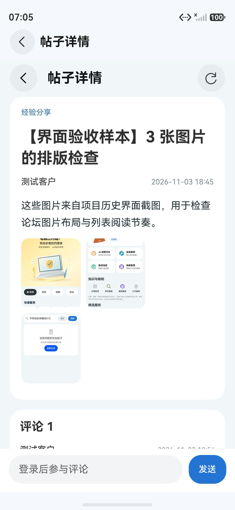

# B：论坛详情、图片阅读与评论 · 本地验收记录

2026-11-04，关联 #85。基于 A 模块提交 `c92a22c` 在独立分支 `codex/forum-detail-polish` 实施；页面使用[论坛设计方向](../../../tasks/current-goals/forum-design-direction.md)中的详情及评论结构，A 的 [PR #91](https://github.com/Xiaoyuan-114/zafu-pchospital-harmonyos/pull/91) 为前置依赖。

## 范围与改动

- 论坛详情：去除系统导航和页面自身重复标题，统一内容面、标题、作者、时间、正文及评论的层级。
- 图片阅读：详情图进入完整比例阅读层，左右切换；双击放大/还原，放大后拖动，切图重置；系统返回先关闭阅读层。
- 评论：输入条占据页面底部空间，键盘打开时缩小内容区；列表评论入口与详情评论数均可定位评论；登录状态变化后重新读取服务端操作权限；评论分页合并去重并按时间排序。
- 继续使用服务端 `actions.canDelete`、既有评论幂等键与会话检查。信息流图片入口显式接线，图片失败时保留单独重试。

## 同条件改前 / 改后

Pura 90 模拟器、同一独立课设库及同一测试帖；改前为 `c92a22c` 游客，改后为作者账号。改后额外展示服务端授权的删除操作。

| 改前 | 改后 |
| --- | --- |
|  |  |

## 已执行检查

| 项目 | 结果和证据 |
| --- | --- |
| 最终构建 | `assembleHap` 成功，HDC 覆盖安装；[构建日志](build.log)、[包和源码指纹](version.json) |
| 回归 | 论坛、登录、会话相关测试 64 项通过，测试文件 ESLint 通过；[测试日志](tests.log) |
| 图片阅读 | 真实三图帖子进入图片层，左右切换、双击放大/还原、放大后拖动，系统返回原帖；[切换](image-second.jpeg)、[放大并拖动](image-pan.jpeg) |
| 游客续接 | 游客在帖子详情点击评论发送进入登录；测试客户登录后返回原帖，自动重新读取帖子和评论权限，作者删除入口显示 |
| 评论 | 输入并发送验收评论，数量由 1 变为 2；确认删除该评论后恢复为 1。输入时键盘上方能看到标题和输入区；系统返回收起键盘并留在详情。[键盘布局](comment-keyboard-after.jpeg) |
| 帖子删除 | 新建明确标注的临时验收帖，以作者身份进入并二次确认删除，返回论坛列表后该帖消失；[确认面板](post-delete-dialog.jpeg) |
| 关联页面 | 点击论坛列表真实图片仍进入对应详情；图片阅读层系统返回后仍停留在原详情；[最终论坛列表](feed-final.jpeg) |
| 评论定位 | 通过 30 段长帖验证详情底部评论数和列表评论入口都能定位评论；[列表直达评论](list-to-comment.jpeg) |

图片切换、键盘和删除截图来自逐步构建的中间版本；最终版本重新核对了列表直达评论与详情布局。构建、安装和操作均通过命令行与 HDC 完成。

## 后续状态

待补图片加载失败后恢复的模拟器操作、工作人员身份和实体手机；图片阅读目前提供双击缩放，双指连续缩放未实现。放大拖动边界当前采用固定值，宽屏和不同尺寸图片需要进一步校准；删除操作菜单留待后续完善。
